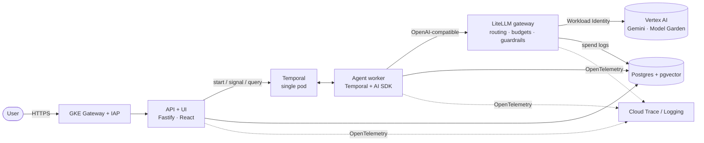

# Durable Agents on GCP

A reference architecture for running AI agents on Google Cloud that **finish the job, safely and on budget**:

- **Durable:** agent runs survive pod failures and resume from their last completed step (Temporal).
- **Governed:** every model call goes through one gateway that routes, enforces per-agent budgets, logs cost and screens prompts (LiteLLM on Vertex AI).
- **Secure by default:** one public entry point behind Google sign-in (IAP), no credentials in application code (Workload Identity), and no secrets in this public repo.
- **Disposable:** Terraform creates the GKE environment when needed and destroys it when idle, with cost guardrails that alert on forecast overspend and enforce a hard cap.

> **Status:** early build. The architecture, decision records, local tooling and cost guardrails are in place. The application, agents and GKE deployment are next (see [Roadmap](#roadmap)).

## Architecture

**Architecture brief:** [`docs/architecture.html`](docs/architecture.html) covers the request path with reliability, cost and security views, what each component does and why it was chosen, the path to production, and verification scenarios. GitHub shows HTML as source, so download the file and open it in a browser.



Only the Gateway is public. Stateless pods (API, worker, LiteLLM) run on Spot capacity; Temporal and Postgres run on on-demand capacity. Only the LiteLLM service account can call Vertex AI.

### Tech stack

| Layer | Choice | Decision record |
|---|---|---|
| UI and API | React + Vite, served by a Fastify API (TypeScript) | [0001](docs/adr/0001-typescript-monorepo.md), [0013](docs/adr/0013-consolidated-workloads.md) |
| Durable runtime | Temporal (TypeScript SDK) | [0002](docs/adr/0002-temporal-durable-runtime.md), [0011](docs/adr/0011-temporal-single-pod.md) |
| Agent logic | Vercel AI SDK inside Temporal activities | [0003](docs/adr/0003-agent-framework.md) |
| Models | Vertex AI: Gemini and Model Garden partner models | [0004](docs/adr/0004-vertex-ai-models.md) |
| LLM gateway | LiteLLM: routing, per-agent budgets, cost tracking | [0005](docs/adr/0005-llm-gateway-litellm.md) |
| Guardrails | Vertex safety filters, injection check at the gateway, tool allow-lists, human approval | [0012](docs/adr/0012-guardrails-lightweight.md) |
| Data | Postgres + pgvector on CloudNativePG (Cloud SQL optional) | [0007](docs/adr/0007-postgres-pgvector.md) |
| Observability | OpenTelemetry to Cloud Trace, Logging and Monitoring | [0008](docs/adr/0008-observability.md) |
| Evals | promptfoo in GitHub Actions | [0009](docs/adr/0009-evals-promptfoo.md) |
| Edge and access | GKE Gateway API + Identity-Aware Proxy | [0010](docs/adr/0010-edge-access-iap.md) |
| Compute | GKE Autopilot, Spot for stateless pods | [0014](docs/adr/0014-gke-autopilot-spot.md) |
| Cost guardrails | Budget alerts, automatic cluster shutdown, billing hard cap | [0015](docs/adr/0015-cost-guardrails.md) |
| Deployment | Apply scripts now, keyless GitHub Actions deploy next; GitOps controller deferred | [0018](docs/adr/0018-deployment-gitops-deferred.md) |
| Tools and skills | Tools as in-cluster MCP servers with per-agent allow-lists; skills as versioned instruction packages | [0020](docs/adr/0020-mcp-tools-and-skills.md) |
| Agent portfolio | Five agents, one per reusable pattern, built on work we can back up | [0019](docs/adr/0019-pattern-agent-portfolio.md) |
| Agent portal UI | Per-agent case workspace, Mission Control overlay, collapsible agent sidebar; light and dark themes | [0021](docs/adr/0021-agent-portal-ui.md) |

All 21 decision records, including superseded ones, are in [`docs/adr/`](docs/adr/).

## Cost

| | Estimate |
|---|---|
| Infrastructure while the cluster is up | ~$0.08–0.15 per hour |
| Model tokens (Flash / Flash-Lite defaults) | ~$0.05–0.50 per hour of active use |
| While the cluster is down | Cents per month |

Estimates use us-central1 list prices and the GKE Free Tier; see [SETUP.md §11](docs/SETUP.md#11-cost-management). The [cost guardrails](docs/SETUP.md#73-cost-guardrails-deploy-first) are deployed before anything else:

- **Alerts:** email when the month is forecast to exceed the budget, and at 50/90/100% of actual spend.
- **Cluster shutdown:** all GKE clusters are deleted at 100% of budget.
- **Cluster time limit:** any cluster older than 8 hours is deleted (checked hourly).
- **Hard cap:** billing is disabled on the project at 120% of budget.

## Repository layout

Organized by what things belong to: one folder per agent, and the platform by layer ([ADR-0016](docs/adr/0016-repository-structure.md)).

```text
.
├── agents/                       # By industry, then one self-contained folder per agent (agents/README.md)
│   ├── general/                  # Industry-neutral: research-summarize, invoice-exception-resolver (building), audit-evidence-collector
│   ├── financial-services/       # Example applications of the patterns, with business cases
│   └── technology/, manufacturing/, healthcare/   # Technology: cve-remediator, finops-cost-sentinel, incident-commander (planned)
├── apps/
│   ├── worker/                   # The Temporal worker that runs every agent (+ Dockerfile, k8s)
│   ├── mcp-docs/                 # Custom MCP server: the synthetic document store (+ Dockerfile)
│   └── mcp-match-engine/         # Custom MCP server: deterministic three-way match, scaled by an HPA
├── packages/
│   └── agent-kit/                # Shared: LiteLLM clients, MCP tools + allow-lists, skills, retry presets, review gate
├── platform/                     # Everything deployed to GCP, by layer (platform/README.md)
│   ├── cost-guardrails/          # Deployed first: budget, alerts, enforcer function, cluster time limit
│   ├── foundation/terraform/     # Persistent: registry, secrets, service accounts, IAP, CI federation
│   ├── cluster/terraform/        # Per session: VPC + NAT, GKE Autopilot, gateway IP and certificate
│   ├── k8s/                      # Kustomize: namespace, policies, Gateway + IAP (base + local/gke overlays)
│   ├── services/                 # Postgres (CloudNativePG), Temporal, LiteLLM + guardrail
│   ├── mcp/                      # In-cluster MCP servers: erp-read, erp-write (MCP Toolbox), docs, match-engine (HPA)
│   └── modules/                  # network, gke-autopilot
├── scripts/                      # Named for when you run them (see scripts/README.md)
│   ├── local/                    # Your PC: toolchain once, then k3d up / apply / down
│   ├── gcp/                      # Once per GCP project: cost guardrails, foundation
│   ├── gke/                      # Each GKE session: up, apply-k8s, down, check-orphans
│   └── lib/                      # Shared functions the scripts load; never run directly
├── docs/
│   ├── RUNBOOK.md                # Step-by-step: run locally and on GKE, with checks
│   ├── SETUP.md                  # Reference: architecture, security rules, cost, layers
│   ├── architecture.html         # Architecture brief
│   └── adr/                      # Architecture decision records
├── .github/workflows/            # Secret scanning on every push and pull request
├── package.json                  # pnpm workspace (TypeScript): pnpm test builds and runs every test
└── .env.example                  # All settings; copy to .env (gitignored)
```

Planned: `apps/api` and `apps/web` (API and review UI), `packages/contracts`. See [SETUP.md §3](docs/SETUP.md#3-repository-layout).

## Getting started

Follow [`docs/RUNBOOK.md`](docs/RUNBOOK.md): every step in order, with a check after each one. The short version, on Windows 11 with WSL2 (Ubuntu) and Docker Desktop:

```bash
# 1. Local toolchain (run inside WSL, from the repo root)
cp .env.example .env                  # then fill in your values
scripts/local/bootstrap-wsl.sh        # gcloud, kubectl, k3d, helm, terraform, gh, gitleaks, pre-commit
scripts/local/verify-tools.sh
scripts/local/install-git-hooks.sh    # secret scanning before every commit

# 2. Local Kubernetes cluster and platform services
gcloud auth login && gcloud auth application-default login
scripts/local/k3d-up.sh
scripts/local/apply-k8s.sh            # Postgres, Temporal, LiteLLM, the agent worker, placeholder API

# 3. GCP cost guardrails (before any other GCP infrastructure)
scripts/gcp/cost-guardrails.sh apply  # deploys in dry-run mode
scripts/gcp/cost-guardrails.sh test   # check the logged decision, then switch to enforce

# 4. Persistent foundation, then a cluster for each session
scripts/gcp/foundation.sh apply
scripts/gke/up.sh                     # ~10 min
scripts/gke/apply-k8s.sh              # Gateway + HTTPS + IAP (one-time OAuth client setup: platform/k8s/README.md)
scripts/gke/down.sh                   # when you're done
```

How the Terraform layers fit together: [`platform/README.md`](platform/README.md#how-the-terraform-works).

## Security

This repository is public and must never contain secrets:

- `.gitignore` blocks `.env`, Terraform state and variable files, kubeconfigs and key files.
- Pre-commit hooks run **gitleaks** and refuse sensitive files even when forced past `.gitignore`.
- GitHub Actions scans the full history on every push and pull request; GitHub secret scanning and push protection are on.
- Workloads authenticate with Workload Identity; runtime secrets live in Secret Manager.

Details: [SETUP.md §4](docs/SETUP.md#4-security--secrets-hygiene-public-repo-rules).

## Roadmap

- [x] Architecture, decision records and architecture brief
- [x] Local toolchain and k3d cluster scripts
- [x] Secret scanning (pre-commit and CI)
- [x] Cost guardrails (Terraform + budget enforcer)
- [x] Terraform: foundation layer (registry, secrets, service accounts, IAP access, CI federation)
- [x] Terraform: cluster layer (VPC + NAT, GKE Autopilot, Workload Identity, gateway IP and certificate)
- [x] Kubernetes platform layer: namespace, service accounts, quota, network policies, Gateway + HTTPS + IAP (`platform/k8s`)
- [x] Platform services: Postgres (CloudNativePG + pgvector), Temporal, LiteLLM with prompt-injection guardrail (`platform/services`)
- [x] Prototype agent portfolio and business cases ([ADR-0017](docs/adr/0017-prototype-agent-portfolio.md))
- [x] Agent portfolio by pattern and tool layer decided ([ADR-0019](docs/adr/0019-pattern-agent-portfolio.md), [ADR-0020](docs/adr/0020-mcp-tools-and-skills.md)); Invoice Exception Resolver designed
- [ ] Invoice Exception Resolver: MCP tools, synthetic ERP and match engine done (M1-M3); workflow and evals next (`agents/general/invoice-exception-resolver`)
- [x] Shared worker, agent-kit, and the first agent: research and summarize, with human review (`agents/general/research-summarize`)
- [ ] Application: API + review UI (design: [ADR-0021](docs/adr/0021-agent-portal-ui.md), [`docs/design/agent-portal`](docs/design/agent-portal/))
- [ ] Evals in CI (promptfoo)
- [ ] Verification scenarios scripted (worker failure, prompt injection, budget cap, approval, trace)
