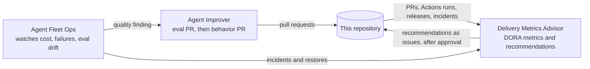

# Platform engineering agents

Agents that run, measure and improve the platform itself and the engineering process around it. They cover three areas:

- **Platform engineering:** keeping the agent fleet healthy, within budget and reviewable.
- **AI capabilities:** making each agent measurably better at the goal its business case sets, without gaming its own tests.
- **Developer experience:** showing how fast and how safely changes reach production, and what to fix first.

Unlike the industry folders, these agents work on this project's own systems: this repository, its pull requests and Actions runs, the Temporal history, the LiteLLM spend logs and each agent's eval results. Where this project's history is too thin to be interesting, a synthetic history fills the gap and is labelled as such. Why this group exists and why Agent Fleet Ops moved here: [ADR-0022](../../docs/adr/0022-platform-engineering-agents.md).

Agents follow the [agent layout](../README.md#layout-of-an-agent), each with a `business-case.md` first.

| Agent | Area | Pattern ([ADR-0019](../../docs/adr/0019-pattern-agent-portfolio.md)) | What it does | Business case | Status |
|---|---|---|---|---|---|
| `agent-fleet-ops` | Platform engineering | Monitor, diagnose, act | Monitors every agent for cost, failures, stuck runs and eval drift; replays failed runs with approval; proposes config changes by pull request; hands quality findings to the Agent Improver | [business case](agent-fleet-ops/business-case.md) | Concept |
| `agent-improver` | AI capabilities | Remediation by pull request | Finds where an agent falls short of its business-case success measures, fixes gaps in its evals, then proposes prompt, skill or model changes by pull request, judged on a held-out set it can't see | [business case](agent-improver/business-case.md) | Concept |
| `delivery-metrics-advisor` | Developer experience | Analysis and explanation | Computes the four DORA metrics from GitHub, explains what moved them, and recommends the changes most likely to improve them | [business case](delivery-metrics-advisor/business-case.md) | Concept |

## How they work together

- **Separation of duties.** Fleet Ops reports eval scores and writes the model-risk evidence pack, so it never edits evals or prompts. The Agent Improver changes agents and evals, but never in the same pull request, and its changes are scored by CI on a held-out set it can't read. Neither agent merges anything.
- **The Improver's pull requests count in the DORA metrics** like anyone else's, so the Delivery Metrics Advisor shows whether automated changes help or hurt lead time and change failure rate.
