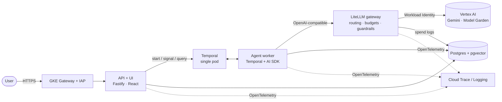

# Durable Agents on GCP — Setup & Demo Guide

> **This is the reference guide:** architecture, security rules, cost, and how the layers fit together. **To run things, follow [RUNBOOK.md](RUNBOOK.md)**: every step in order, with a check after each.
> **Workflow:** Build locally (k3d) → Deploy to GKE (Terraform) for testing → Demo from GKE → Tear down to save cost.

---

## Table of Contents

1. [Project Overview](#1-project-overview)
2. [Architecture & Tech Stack](#2-architecture--tech-stack)
3. [Repository Layout](#3-repository-layout)
4. [Security & Secrets Hygiene (Public Repo Rules)](#4-security--secrets-hygiene-public-repo-rules)
5. [Local PC Setup](#5-local-pc-setup)
6. [Local Kubernetes Cluster (k3d)](#6-local-kubernetes-cluster-k3d)
7. [GCP Project Setup](#7-gcp-project-setup)
8. [GKE Infrastructure with Terraform](#8-gke-infrastructure-with-terraform)
9. [Building & Deploying the Agents](#9-building--deploying-the-agents)
10. [Demo Scripts](#10-demo-scripts)
11. [Cost Management](#11-cost-management)
12. [Troubleshooting](#12-troubleshooting)
13. [References](#13-references)

---

## 1. Project Overview

- **Goal:** Build and run AI agent prototypes on GKE that finish the job, safely and on budget.
- **This guide:** Everything needed to rebuild the platform from scratch and run the demos.
- **Prototype catalog** (one row per agent):

| # | Agent | Description | Stack | Status |
|---|-------|-------------|-------|--------|
| 1 | `invoice-exception-resolver` | Works three-way-match exceptions: evidence, cited proposal, vendor follow-up, approval before anything changes what is paid | Shared platform + MCP Toolbox (synthetic ERP), filesystem MCP, custom `match-engine` | Designed |
| 2 | `cve-remediator` | Upgrades a vulnerable dependency, tests it in a sandbox, opens a pull request with the evidence | Shared platform + GitHub MCP, OSV.dev, Trivy, custom `sandbox-runner` (GKE Sandbox) | Planned |
| 3 | `audit-evidence-collector` | Collects IT general controls evidence, tests it against control rules, assembles an audit packet | Shared platform + GitHub MCP, Cloud Asset Inventory, audit logs | Planned |
| 4 | `finops-cost-sentinel` | Explains cost changes, flags idle compute and GPU spend, proposes rightsizing behind approval | Shared platform + MCP Toolbox (BigQuery billing export, FOCUS sample data), GitHub MCP | Planned |
| 5 | `incident-commander` | Correlates alerts with recent changes, proposes a rollback a person approves, drafts the postmortem | Shared platform + Kubernetes, Prometheus and Grafana MCP, demo app with injected faults | Planned |

Patterns, selection and build order: [ADR-0019](adr/0019-pattern-agent-portfolio.md). Tools and skills: [ADR-0020](adr/0020-mcp-tools-and-skills.md). The earlier financial-services agents ([ADR-0017](adr/0017-prototype-agent-portfolio.md)) remain as example applications in `agents/financial-services/`.

## 2. Architecture & Tech Stack

### 2.1 Stack summary

| Layer | Choice | Decision record |
|---|---|---|
| UI | React + TypeScript (Vite SPA), served by the API | [ADR-0001](adr/0001-typescript-monorepo.md), [ADR-0013](adr/0013-consolidated-workloads.md) |
| API | Node + TypeScript (Fastify) | [ADR-0001](adr/0001-typescript-monorepo.md) |
| Durable runtime | Temporal (TypeScript SDK); single dev-server pod with SQLite on a persistent volume | [ADR-0002](adr/0002-temporal-durable-runtime.md), [ADR-0011](adr/0011-temporal-single-pod.md) |
| Agent logic | Vercel AI SDK inside Temporal activities; one worker, one task queue per agent | [ADR-0003](adr/0003-agent-framework.md), [ADR-0013](adr/0013-consolidated-workloads.md) |
| Models | Vertex AI — Gemini + Model Garden partner models, Workload Identity | [ADR-0004](adr/0004-vertex-ai-models.md) |
| LLM gateway (routing, budgets, cost) | LiteLLM proxy | [ADR-0005](adr/0005-llm-gateway-litellm.md) |
| Guardrails | Vertex safety filters + Flash-Lite injection check in LiteLLM + app-side allow-lists/approvals; Presidio deferred; Model Armor for production | [ADR-0012](adr/0012-guardrails-lightweight.md) |
| Data | One Postgres + pgvector (CloudNativePG; Cloud SQL optional) | [ADR-0007](adr/0007-postgres-pgvector.md) |
| Observability | OpenTelemetry exported directly to Cloud Trace/Logging/Monitoring; Langfuse deferred | [ADR-0008](adr/0008-observability.md), [ADR-0013](adr/0013-consolidated-workloads.md) |
| Evals | promptfoo in GitHub Actions | [ADR-0009](adr/0009-evals-promptfoo.md) |
| Edge & access | GKE Gateway API + Identity-Aware Proxy + spend caps | [ADR-0010](adr/0010-edge-access-iap.md) |
| Compute | GKE Autopilot; Spot for stateless pods, on-demand for Postgres and Temporal | [ADR-0014](adr/0014-gke-autopilot-spot.md) |

**Footprint:** 5 workload pods (api, worker, LiteLLM, Temporal, Postgres) plus the CloudNativePG operator — about 2 vCPU / 5 GB requested. Visual walkthrough: [`docs/architecture.html`](architecture.html).

### 2.2 Request flow (GKE)



Only the Gateway is public. Everything else is `ClusterIP`. Only the LiteLLM service account has Vertex AI permissions.

### 2.3 Local vs. GKE differences

| Concern | Local (k3d) | GKE |
|---|---|---|
| Temporal | Dev-server pod | Same dev-server pod, on-demand capacity |
| Postgres | CloudNativePG | CloudNativePG (default) or Cloud SQL |
| Vertex auth | Your ADC, mounted as a local-only secret | Workload Identity |
| Ingress / auth | k3d load balancer on `localhost`, no auth | GKE Gateway + IAP |
| Traces | Jaeger (optional) | Cloud Trace |
| Secrets | `.env` → K8s Secret | Secret Manager |
| Capacity | 3 k3d nodes on your PC | Autopilot: Spot for stateless, on-demand for stateful |

### 2.4 Decision records

Each significant choice has an Architecture Decision Record (ADR) in [`docs/adr/`](adr/). To change a decision, add a new ADR that supersedes the old one rather than rewriting history. Start from the [template](adr/template.md).

| ADR | Decision | Status |
|---|---|---|
| [0001](adr/0001-typescript-monorepo.md) | TypeScript monorepo (React/Vite, Fastify) | Accepted, amended by 0013 |
| [0002](adr/0002-temporal-durable-runtime.md) | Temporal as durable runtime | Accepted, GKE deployment superseded by 0011 |
| [0003](adr/0003-agent-framework.md) | Vercel AI SDK inside Temporal activities | Accepted |
| [0004](adr/0004-vertex-ai-models.md) | Vertex AI models with Workload Identity | Accepted |
| [0005](adr/0005-llm-gateway-litellm.md) | LiteLLM gateway: routing, budgets, cost | Accepted |
| [0006](adr/0006-guardrails.md) | Presidio + LLM Guard | Superseded by 0012 |
| [0007](adr/0007-postgres-pgvector.md) | One Postgres + pgvector on CloudNativePG | Accepted, amended by 0011 |
| [0008](adr/0008-observability.md) | OpenTelemetry → Cloud Trace; Langfuse deferred | Accepted, amended by 0013 |
| [0009](adr/0009-evals-promptfoo.md) | promptfoo evals in CI | Accepted, amended by 0016 |
| [0010](adr/0010-edge-access-iap.md) | GKE Gateway + IAP + spend caps | Accepted |
| [0011](adr/0011-temporal-single-pod.md) | Temporal as a single dev-server pod | Accepted |
| [0012](adr/0012-guardrails-lightweight.md) | Lightweight, layered guardrails | Accepted |
| [0013](adr/0013-consolidated-workloads.md) | API serves UI; one shared worker; no collector | Accepted |
| [0014](adr/0014-gke-autopilot-spot.md) | Autopilot + Spot for stateless pods | Accepted |
| [0015](adr/0015-cost-guardrails.md) | Budget alerts, cluster auto-shutdown, billing hard cap | Accepted |
| [0016](adr/0016-repository-structure.md) | Repo organized by agent and by platform layer | Accepted |
| [0017](adr/0017-prototype-agent-portfolio.md) | Five prototype financial-services agents, with business cases | Superseded by 0019 |
| [0018](adr/0018-deployment-gitops-deferred.md) | Deploy with scripts and keyless CI; GitOps controller (Argo CD) deferred | Accepted |
| [0019](adr/0019-pattern-agent-portfolio.md) | Five agents, one per reusable pattern; financial-services agents become example applications | Proposed |
| [0020](adr/0020-mcp-tools-and-skills.md) | Tools as in-cluster MCP servers with per-agent allow-lists; skills as versioned packages | Proposed |
| [0021](adr/0021-agent-portal-ui.md) | Agent portal: case workspace per agent, Mission Control overlay, agent sidebar | Accepted |

## 3. Repository Layout

```text
durable-agents-gcp/
├── agents/                    # One folder per industry, then one per agent (see agents/README.md)
│   └── <industry>/<agent-name>/
│       ├── src/workflows/     # Deterministic Temporal workflows
│       ├── src/activities/    # Model and tool calls (AI SDK → LiteLLM)
│       ├── src/tools/         # Allow-listed tool definitions
│       ├── src/prompts/       # Versioned prompt templates
│       ├── test/              # Workflow and activity tests
│       └── evals/             # promptfoo suite for this agent
├── apps/
│   ├── api/                   # Fastify API: serves the UI, starts/signals workflows
│   ├── web/                   # React + Vite UI (built into the api image)
│   └── worker/                # Single Temporal worker; registers every agent
├── packages/
│   ├── agent-kit/             # Shared plumbing: LiteLLM client, retry policies, approvals, telemetry
│   └── contracts/             # Zod schemas shared by UI, API and agents
├── platform/                  # Everything deployed to GCP, by layer (see platform/README.md)
│   ├── cost-guardrails/       # Deploy first
│   │   ├── terraform/         # Budget, alerts, Pub/Sub, cluster TTL scheduler
│   │   └── enforcer/          # Cloud Run function: deletes clusters / disables billing at limits
│   ├── foundation/terraform/  # Persistent: state bucket, registry, secrets, service accounts
│   ├── cluster/terraform/     # Ephemeral: VPC, GKE Autopilot, Gateway + IAP
│   ├── services/              # temporal/, litellm/ (incl. guardrail evals), postgres/
│   ├── k8s/                   # Kustomize base/ + overlays/local (k3d), overlays/gke
│   └── modules/               # Shared Terraform modules
├── scripts/                   # Named for when you run them (see scripts/README.md)
│   ├── local/                 # Your PC: toolchain once, then each k3d session
│   ├── gcp/                   # Once per GCP project: cost guardrails, foundation
│   ├── gke/                   # Each GKE session: up, apply-k8s, down
│   ├── demo/                  # Verification scenario runners (planned)
│   └── lib/                   # Shared functions the scripts load; never run directly
├── docs/
│   ├── RUNBOOK.md             # Step-by-step run guide with checks
│   ├── SETUP.md               # This file (reference)
│   ├── architecture.html      # Visual architecture walkthrough
│   └── adr/                   # Architecture decision records
├── .env.example               # Template only — never commit .env
├── .gitignore
├── .pre-commit-config.yaml
└── README.md
```

## 4. Security & Secrets Hygiene (Public Repo Rules)

**Rule #1: Nothing sensitive is ever committed.** This includes API keys, service-account JSON keys, kubeconfigs, Terraform state, `.tfvars` with real values, project IDs/billing IDs (treat as semi-sensitive), and personal emails.

### 4.1 What is committed vs. not

| Committed ✅ | Never committed ❌ |
|---|---|
| `.env.example`, `terraform.tfvars.example` | `.env`, `*.tfvars` (real values) |
| Terraform code | `*.tfstate`, `*.tfstate.backup`, `.terraform/` |
| K8s manifests referencing secret *names* | K8s `Secret` manifests with values |
| Scripts that read from env / Secret Manager | Service-account key files (`*.json` keys) |
| | `kubeconfig`, `~/.config/gcloud/` |

### 4.2 Guardrails (automated)

- `.gitignore` covering the "never" list above — `TODO`: [`.gitignore`](../.gitignore)
- Pre-commit hooks with **gitleaks** secret scanning — [`.pre-commit-config.yaml`](../.pre-commit-config.yaml)
- Install script: [`scripts/local/install-git-hooks.sh`](../scripts/local/install-git-hooks.sh)
- GitHub settings: enable **Secret scanning** + **Push protection** on the repo.
- Optional CI check: GitHub Action running gitleaks on every PR — `.github/workflows/secret-scan.yml`

### 4.3 Secret handling patterns

- **Local:** values in `.env` (gitignored) → loaded into k3d as K8s Secrets by [`scripts/local/load-secrets.sh`](../scripts/local/load-secrets.sh).
- **GCP:** values in **Secret Manager** (generated by the foundation Terraform) → synced into Kubernetes Secrets by `scripts/gke/apply-k8s.sh` (details in `platform/services/README.md`).
- **Auth to GCP APIs from pods:** **Workload Identity Federation for GKE** (no JSON keys).
- **Terraform state:** remote backend in a private GCS bucket (created by `platform/foundation/terraform`).
- **Terraform auth:** `gcloud auth application-default login` (no key files).

### 4.4 Pre-push checklist

- [ ] `pre-commit run --all-files` passes
- [ ] `git status` shows no `.env`, `.tfvars`, `.tfstate`, or `*.json` keys
- [ ] No project ID / billing ID hard-coded (use variables)

## 5. Local PC Setup

**Host:** Windows 11 Pro + **WSL2 (Ubuntu)**. All Linux tooling runs inside WSL2; Docker Desktop provides the engine with WSL integration enabled.

### 5.1 Prerequisites

| Tool | Purpose | Install via |
|---|---|---|
| WSL2 + Ubuntu | Linux environment | `wsl --install -d Ubuntu` (PowerShell, admin) |
| Docker Desktop | Container engine (WSL2 backend) | winget / installer |
| `kubectl` | Kubernetes CLI | script |
| `k3d` | Local k3s clusters in Docker | script |
| `helm` | Package manager for K8s | script |
| `kustomize` | Manifest overlays (built into kubectl) | — |
| `gcloud` CLI + `gke-gcloud-auth-plugin` | GCP / GKE access | script |
| `terraform` | Infrastructure as code | script |
| `git`, `gh` | Source control / GitHub CLI | script |
| `pre-commit`, `gitleaks` | Secret scanning | script |
| Python 3.12+ / `uv` | Agent development | script |
| VS Code + WSL extension | Editor | installer |

### 5.2 Automation scripts

- Windows side (once, by hand): `wsl --install -d Ubuntu` in admin PowerShell, then Docker Desktop with WSL integration and VS Code. Steps in [RUNBOOK.md Part 0](RUNBOOK.md#0-prepare-your-pc-once).
- WSL side: [`scripts/local/bootstrap-wsl.sh`](../scripts/local/bootstrap-wsl.sh) — installs all CLI tools above with pinned versions.
- Verify: [`scripts/local/verify-tools.sh`](../scripts/local/verify-tools.sh) — prints versions, fails if anything is missing.

### 5.3 Notes on `sudo`

- `sudo` is needed only for package installs inside WSL (`apt`, moving binaries to `/usr/local/bin`).
- **Do not** run `k3d`, `kubectl`, or `docker` with `sudo` — with Docker Desktop's WSL integration your user already has access. Running k3d as root writes the kubeconfig to `/root/.kube/config`, which `kubectl` as your user won't see.

## 6. Local Kubernetes Cluster (k3d)

### 6.1 Create the cluster

Script: [`scripts/local/k3d-up.sh`](../scripts/local/k3d-up.sh)

```bash
k3d cluster create agents-local \
  --servers 1 \
  --agents 2 \
  --api-port 6550 \
  -p "80:80@loadbalancer" \
  -p "443:443@loadbalancer" \
  --registry-create gke-registry.localhost:5000 \
  --wait
```

| Flag | Why |
|---|---|
| `--servers 1 --agents 2` | 1 control plane + 2 workers — mimics a small GKE node pool |
| `--api-port 6550` | Fixed API port so kubeconfig is stable across rebuilds |
| `-p 80/443@loadbalancer` | Expose ingress on `localhost` |
| `--registry-create` | Local image registry, analogous to Artifact Registry |
| `--wait` | Block until the cluster is ready (script-friendly) |

> **Note:** push images to `localhost:5000`; the cluster pulls them by the registry's own name. Some k3d versions add a `k3d-` prefix to that name and some don't (`k3d registry list` shows it), so `scripts/local/build-push.sh` looks it up rather than assuming.

### 6.2 Post-create setup

- Verify: `kubectl get nodes`, `kubectl cluster-info`
- Ingress: k3s ships Traefik, which the local overlay uses for `http://localhost`. GKE uses the Gateway API instead (`platform/k8s/overlays/gke`).
- Deploy the platform: [`scripts/local/apply-k8s.sh`](../scripts/local/apply-k8s.sh) (applies `platform/k8s/overlays/local`). Checks: [RUNBOOK.md 1.2](RUNBOOK.md#12-verify)
- Build & push agent images (once agents exist): [`scripts/local/build-push.sh`](../scripts/local/build-push.sh)
- Optional third-party keys for agents: [`scripts/local/load-secrets.sh`](../scripts/local/load-secrets.sh) copies `SECRET_*` values from `.env` into a k3d Secret. The platform doesn't need it

### 6.3 Tear down

Script: [`scripts/local/k3d-down.sh`](../scripts/local/k3d-down.sh) → `k3d cluster delete agents-local`

## 7. GCP Project Setup

### 7.1 One-time manual steps (console)

- Create/choose a GCP project; link billing.
- Enable MFA on the Google account.
- Make sure your account has **Billing Account Administrator** on the billing account (needed to create budgets and the billing hard cap).
- Then deploy the cost guardrails (Section 7.3) **before anything else**.

### 7.2 Sign in and set up the foundation

```bash
gcloud auth login
gcloud auth application-default login     # credentials Terraform uses
gcloud config set project <your-project-id>
scripts/gcp/cost-guardrails.sh apply      # Section 7.3, always first
scripts/gcp/foundation.sh plan
scripts/gcp/foundation.sh apply
```

The scripts create the Terraform state bucket if it doesn't exist, and each Terraform layer turns on the APIs it needs. The foundation layer ([`platform/foundation/terraform`](../platform/foundation/terraform)) creates:

- **Artifact Registry** repository `agents`, keeping the 2 newest versions of each image
- **Postgres backup bucket** with 30-day retention
- **Workload service accounts** `wl-api`, `wl-worker`, `wl-litellm` (the only one with Vertex AI access), `wl-postgres`
- **Secrets** with generated values: `litellm-master-key`, `postgres-app-password`, `postgres-litellm-password`
- **IAP access** for `IAP_MEMBERS`
- **GitHub Actions federation** for `GITHUB_REPOSITORY` (no stored keys)

How the Terraform is organized, and how to read a plan: [`platform/README.md`](../platform/README.md#how-the-terraform-works).

### 7.3 Cost guardrails (deploy first)

Design: [ADR-0015](adr/0015-cost-guardrails.md). Terraform: [`platform/cost-guardrails/terraform`](../platform/cost-guardrails/terraform). Function: [`platform/cost-guardrails/enforcer`](../platform/cost-guardrails/enforcer). Script: [`scripts/gcp/cost-guardrails.sh`](../scripts/gcp/cost-guardrails.sh).

| Guardrail | Trigger | Action |
|---|---|---|
| Forecast alert | Month-end spend **forecast** reaches 80% / 100% of budget | Email |
| Spend alert | **Actual** month-to-date spend reaches 50% / 90% / 100% | Email |
| Cluster shutdown | Actual spend reaches 100% (`BUDGET_STOP_CLUSTERS_AT`) | Delete all GKE clusters |
| Cluster time limit | Any cluster older than 8 hours (`CLUSTER_MAX_HOURS`), checked hourly | Delete that cluster |
| Hard cap | Actual spend reaches 120% (`BUDGET_DISABLE_BILLING_AT`) | Disable billing on the project |

Steps (in WSL, after setting the `Cost guardrails` block in `.env`):

```bash
scripts/gcp/cost-guardrails.sh plan
scripts/gcp/cost-guardrails.sh apply      # deploys in dry_run mode
scripts/gcp/cost-guardrails.sh test       # fake 130% notification; check the logged decision
# set BUDGET_ENFORCEMENT_MODE=enforce in .env, then:
scripts/gcp/cost-guardrails.sh apply
scripts/gcp/cost-guardrails.sh status     # billing state, budgets, clusters, recent decisions
```

> The budget subtracts Free Tier usage and usage discounts but **not** promotional credits, so the $300 trial credit can't hide real spend (Section 11.4).
>
> Budget data lags real usage by hours, so spend can overshoot a threshold before the enforcer acts. The 8-hour cluster limit and LiteLLM per-agent budgets are the faster controls. If billing is ever disabled, re-enable it with `gcloud billing projects link $PROJECT_ID --billing-account=$BILLING_ACCOUNT_ID`.

### 7.4 Configuration variables

All settings are documented in [`.env.example`](../.env.example): project and region, Terraform state bucket, cost guardrails (billing account, monthly budget, alert emails, enforcement mode and thresholds), and local k3d settings.

## 8. GKE Infrastructure with Terraform

### 8.1 Design decisions

- **Cluster mode:** **GKE Autopilot** (regional). Stateless pods (api, worker, LiteLLM) on **Spot**; Postgres and Temporal on on-demand ([ADR-0014](adr/0014-gke-autopilot-spot.md)). A GKE Standard variant may come later if node-pool control is needed.
- **Networking:** custom VPC + subnet with secondary ranges (VPC-native).
- **Identity:** Workload Identity enabled; per-agent GCP service accounts bound to K8s service accounts.
- **Registry:** Artifact Registry (Docker) in the same region, with a cleanup policy that keeps only the last 2 versions of each image (the Free Tier covers 0.5 GB).
- **Database:** in-cluster CloudNativePG by default; `use_cloud_sql = true` switches to Cloud SQL ([ADR-0007](adr/0007-postgres-pgvector.md)).
- **Edge:** GKE Gateway API + IAP + managed certificate ([ADR-0010](adr/0010-edge-access-iap.md)).
- **What persists vs. what is ephemeral:**

| Persistent (cheap, keep) | Ephemeral (destroy after demo) |
|---|---|
| State bucket, Artifact Registry, Secret Manager secrets, service accounts, DB backups in GCS | VPC/NAT (optional), GKE cluster, node pools, load balancers, in-cluster Postgres |

### 8.2 Module structure

| Layer | Folder | State prefix | Script |
|---|---|---|---|
| Cost guardrails | [`platform/cost-guardrails/terraform`](../platform/cost-guardrails/terraform) | `cost-guardrails` | `scripts/gcp/cost-guardrails.sh` |
| Foundation (persistent) | [`platform/foundation/terraform`](../platform/foundation/terraform) | `foundation` | `scripts/gcp/foundation.sh` |
| Cluster (per session) | [`platform/cluster/terraform`](../platform/cluster/terraform), using [`platform/modules/network`](../platform/modules/network) and [`gke-autopilot`](../platform/modules/gke-autopilot) | `cluster` | `scripts/gke/up.sh`, `down.sh` |

The cluster layer reads foundation's outputs (service accounts, namespace) through `terraform_remote_state`. Values come from `.env` as `TF_VAR_*`; each layer has a `terraform.tfvars.example`. Full explanation: [`platform/README.md`](../platform/README.md#how-the-terraform-works).

### 8.3 Spin up / spin down

| Action | Script | Approx. time |
|---|---|---|
| Create cluster | [`scripts/gke/up.sh`](../scripts/gke/up.sh): VPC + NAT, Autopilot cluster, Workload Identity bindings, gateway IP and certificate, then `get-credentials` and the `agents` namespace | ~10 min |
| Preview changes | `scripts/gke/up.sh plan` | <1 min |
| Apply platform | [`scripts/gke/apply-k8s.sh`](../scripts/gke/apply-k8s.sh): CloudNativePG operator, secrets, namespace and policies, Postgres, Temporal, LiteLLM, Gateway + IAP ([k8s](../platform/k8s/README.md), [services](../platform/services/README.md)) | ~10 min, plus 15–60 min for the certificate |
| Deploy agents | `scripts/gke/deploy.sh` (planned with `apps/`) | — |
| Destroy cluster | [`scripts/gke/down.sh`](../scripts/gke/down.sh): backs up Postgres to GCS, deletes Gateways, destroys the cluster layer, then checks for leftovers. `--yes` skips the prompt, `--no-backup` skips the backup | ~10–15 min |
| Check for leftovers | [`scripts/gke/check-orphans.sh`](../scripts/gke/check-orphans.sh): clusters, load balancers, reserved IPs, unattached disks, NAT routers | <1 min |

> The app hostname defaults to `<gateway-ip>.sslip.io`. Its Google-managed certificate turns ACTIVE 15–60 minutes after the Gateway is deployed, and the IP is new each session, so start `up.sh` well before you need HTTPS.

## 9. Building & Deploying the Agents

### 9.1 Per-agent conventions

- Each agent in `agents/<industry>/<name>/` is a workspace package with its own workflows, activities, task queue and `README.md`. The shared worker in `apps/worker` registers all of them ([ADR-0013](adr/0013-consolidated-workloads.md)). Conventions: [agents/README.md](../agents/README.md).
- LLM access: agents call only the LiteLLM gateway (model aliases `fast` / `smart`) with a per-agent virtual key and budget, created by the apply scripts (`AGENT_BUDGETS_USD` in `scripts/lib/k8s.sh`). They never hold Vertex credentials or the master key ([ADR-0005](adr/0005-llm-gateway-litellm.md)).
- LLM calls and tool calls live in Temporal **activities**, never in workflow code ([ADR-0002](adr/0002-temporal-durable-runtime.md)). Shared plumbing (model clients, retry presets, heartbeats, the human review gate) is in [`packages/agent-kit`](../packages/agent-kit).

### 9.2 Build, test and deploy

| Step | Local (k3d) | GKE |
|---|---|---|
| Build and test | `pnpm install && pnpm test` (TypeScript build, unit tests, workflow tests on Temporal's time-skipping server) | same |
| Image | [`scripts/local/build-push.sh`](../scripts/local/build-push.sh): builds `apps/worker/Dockerfile`, pushes to the k3d registry | [`scripts/gke/build-push.sh`](../scripts/gke/build-push.sh): pushes to Artifact Registry |
| Deploy | `scripts/local/apply-k8s.sh` (runs build-push first) | `scripts/gke/apply-k8s.sh` (runs build-push first) |

Image tags are the commit, plus a timestamp when the tree has uncommitted changes. Each build-push records the image in the overlay's gitignored `images.env`, which the overlay copies into the worker Deployment.

### 9.3 CI/CD (optional, later)

- GitHub Actions → GCP via **Workload Identity Federation** (no stored keys) — `.github/workflows/deploy.yml`: build, push and apply the `gke` overlay on `main`
- No GitOps controller (Argo CD, Flux, Config Sync) for now: clusters are disposable and image tags and agent keys are created at deploy time ([ADR-0018](adr/0018-deployment-gitops-deferred.md))

## 10. Demo Scripts

### 10.1 Demo runbook template (one per agent)

- **Summary** (30 sec): problem, solution, GCP services used
- **Pre-demo checklist:** cluster up, pods healthy, endpoint reachable, budget OK
- **Live walkthrough:** steps + expected output
- **Key points:** architecture, security (Workload Identity, Secret Manager), cost controls, scaling
- **Fallback:** recorded video / screenshots if live demo fails
- **Post-demo:** run `scripts/gke/down.sh`

### 10.2 Automation

- [`scripts/demo/preflight.sh`](../scripts/demo/preflight.sh) — checks cluster, pods, endpoints
- [`scripts/demo/run-<agent>.sh`](../scripts/demo/) — scripted interaction with each agent
- [`scripts/demo/show-architecture.sh`](../scripts/demo/show-architecture.sh) — `kubectl` views for walkthrough (nodes, pods, HPA, service accounts)

### 10.3 Demo catalog

| Agent | Runbook | Recording | Duration |
|---|---|---|---|
| `TODO` | `docs/demos/<agent>.md` | `TODO` | `TODO` |

## 11. Cost Management

### 11.1 Estimated cost per hour (cluster up)

Estimates from us-central1 list prices; verify with the [GCP pricing calculator](https://cloud.google.com/products/calculator). Details in [ADR-0014](adr/0014-gke-autopilot-spot.md).

| Item | Approx. $/hr |
|---|---|
| Autopilot pods (~2 vCPU / 5 GB requested, mostly Spot) | ~$0.04–0.06 |
| External load balancer forwarding rule | ~$0.025 |
| Cloud NAT, in-use static IP, small disks | ~$0.01–0.02 |
| Cluster management fee | ~$0 (free tier credit, one cluster) |
| **Infrastructure total** | **~$0.08–0.15** |
| Vertex AI tokens (Flash / Flash-Lite defaults) | ~$0.05–0.50; more with larger models |

For comparison, the original full stack (Helm Temporal, LLM Guard, Presidio, separate pods) was ~$0.13–0.30/hr before tokens.

### 11.2 Cost while the cluster is down

Cents per month: state and backup buckets, Artifact Registry images, Secret Manager. **Release the static IP in `down.sh`** — an idle reserved IP costs about $7/month.

### 11.3 Controls

- Cost guardrails (Section 7.3): forecast and spend alerts, automatic cluster shutdown at 100% of budget, an 8-hour cluster time limit, and a billing hard cap at 120% ([ADR-0015](adr/0015-cost-guardrails.md)).
- Per-agent LiteLLM budgets cap model spend inside the platform ([ADR-0005](adr/0005-llm-gateway-litellm.md)).
- Destroy the cluster after every session; keep only the persistent layer.
- Default model aliases to Flash / Flash-Lite; use larger models only where a step needs them.
- On k3d, both aliases use Flash-Lite by default, and `LOCAL_MODELS=mock` replaces model calls with free canned answers for testing everything except answer quality ([RUNBOOK §1.3](RUNBOOK.md#13-run-the-research-agent)).
- Delete unused Artifact Registry images (cleanup policy in Terraform).
- Watch for orphans: external load balancers, persistent disks, static IPs, Cloud NAT.
- `TODO`: Record actual cost per demo session.

### 11.4 Free Tier and free trial

Source: [Google Cloud Free Tier](https://cloud.google.com/free), checked 2026-11-17. Limits are monthly, per billing account unless noted, and don't roll over.

| Service | Free Tier | Effect on this project |
|---|---|---|
| GKE | Cluster management fee for one Autopilot or zonal cluster | Cluster fee is ~$0; pods, load balancer and disks are billed |
| Cloud Run functions | 2M invocations, 400,000 GB-seconds, 200,000 GHz-seconds | Budget enforcer runs free |
| Cloud Build | 2,500 build-minutes (e2-standard-2) | Image and function builds free |
| Pub/Sub | 10 GiB of messages | Budget notifications free |
| Cloud Storage | 5 GB-months, us-central1 / us-east1 / us-west1 only | State and backup buckets free in us-central1 |
| Artifact Registry | 0.5 GB storage | Keep only recent images (cleanup policy); a few cents beyond |
| Secret Manager | 6 active secret versions, 10,000 accesses | We'll slightly exceed it: about $0.06 per extra version |
| Logging / Monitoring | 50 GiB logs per **project**; non-chargeable metrics free | Fits our log volume |
| Load balancing, Cloud NAT | Not in Free Tier | Already in the hourly estimate (Section 11.1) |
| Cloud Scheduler, Cloud Trace | Not on the Free Tier page; small allowances on their pricing pages | Expected to be cents at most |
| Vertex AI (Gemini, Model Garden) | Not in Free Tier | Model tokens are always billed |

**$300 free trial (90 days):**

- For trials started on or after 2026-11-16, the credit **can't pay for Vertex AI (Gemini) or partner models**. Model calls are real spend, and Vertex AI may require upgrading to a paid billing account. Check in the console before the first model call.
- Trial accounts can't use GPUs or request quota increases. Neither is needed here.
- If the trial runs out (credit used or 90 days passed) without an upgrade, billing stops and resources are deleted after a 30-day grace period. After upgrading, the cost guardrails (Section 7.3) are the only spending cap.
- The budget deliberately ignores promotional credits, so guardrail alerts reflect what you'd pay without the trial.

## 12. Troubleshooting

| Symptom | Likely cause | Fix |
|---|---|---|
| `kubectl` can't find cluster after k3d create | k3d ran with `sudo` | Recreate without `sudo` |
| Image pull errors on k3d (`no such host`) | Wrong registry name in the image | Re-run `scripts/local/build-push.sh`; it uses the name from `k3d registry list` |
| `gke-gcloud-auth-plugin` not found | Plugin not installed | `gcloud components install gke-gcloud-auth-plugin` / apt package |
| Pod 403 calling Vertex AI | Workload Identity binding missing | Check KSA annotation + IAM binding |
| `TODO` | | |

## 13. References

- k3d: https://k3d.io
- GKE docs: https://cloud.google.com/kubernetes-engine/docs
- Terraform Google provider: https://registry.terraform.io/providers/hashicorp/google/latest/docs
- Workload Identity for GKE: https://cloud.google.com/kubernetes-engine/docs/how-to/workload-identity
- Secret Manager CSI: https://cloud.google.com/secret-manager/docs/secret-manager-managed-csi-component
- gitleaks: https://github.com/gitleaks/gitleaks
